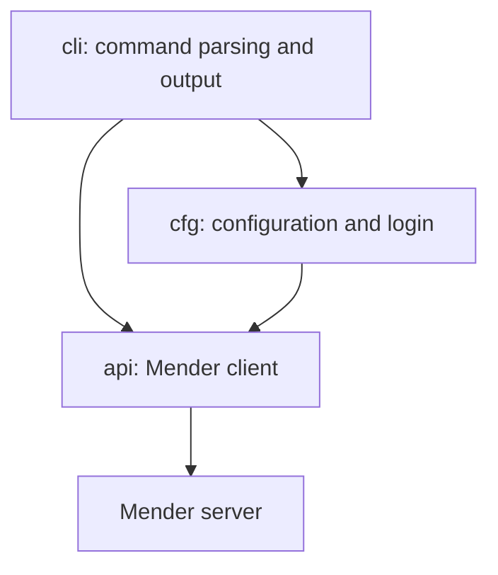

# Architecture

The workspace separates HTTP API access, configuration, and command dispatch into
three crates:

`api` owns the HTTP client and data transfer types. `Client` combines a reqwest
client with a server URL. The `Login` implementation authenticates with basic
authentication and consumes the client to produce a `Session` holding the bearer
token.

Endpoint traits such as `Devices`, `Groups`, and `Deployments` are implemented on
`Session`. They select endpoint paths, serialize request bodies, check HTTP
status codes, and deserialize responses into types from `dto`. `DeviceProxy`
provides operations scoped to one device.

The session's HTTP methods delegate to a private request builder that sets the
method, URL, and bearer authentication. URL construction replaces the base URL's
path and replaces its query when one is supplied; an omitted query preserves
the base URL's query. Endpoint methods remain responsible for sending requests
and interpreting responses.

`Pager` fetches individual pages and can collect results. `Pages` exposes pages
through an asynchronous `next` method, while `PaginatedIterator` exposes individual
items. These types are re-exported from the API crate.

`cfg` exposes `ConfigArgs` and loads optional TOML configuration through
`ConfigFile`. Its login helper resolves connection settings and credentials,
configures the HTTP client, and authenticates. The CLI implements `ConfigArgs`
for its parsed arguments, then dispatches commands using the resulting session.
Command handlers format output and convert errors to process exit codes.

The session request-building test constructs requests without contacting a
server, checking HTTP methods, URL handling, and bearer authentication. Run the
workspace checks with `cargo test --workspace --all-features`,
`cargo clippy --all-features`, and `cargo +nightly fmt --check`.
